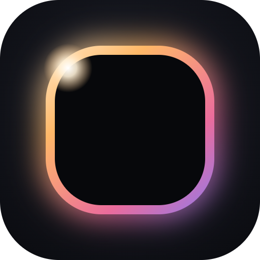
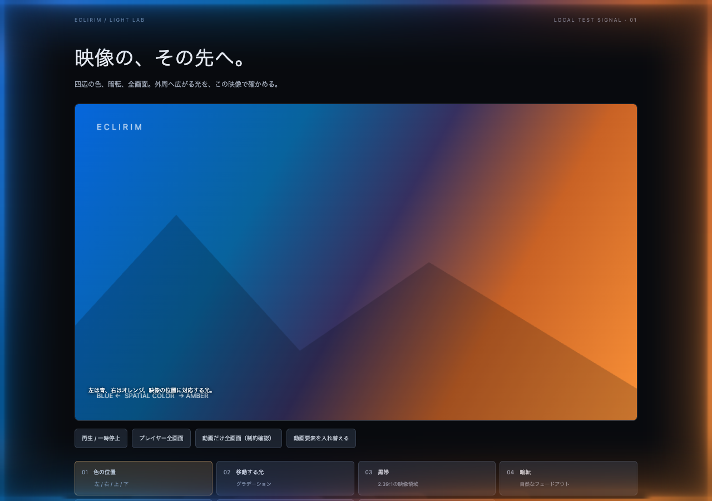

[English](README.md) | [日本語](README.ja.md)

The main English guide is [README.md](README.md).

# ECLIRIM

A Chrome extension that lights the edges of your browser’s page area with the colors and sound of the video you are watching. Video analysis, audio analysis, and lighting run on your device.

**0.9.9 · Global Update (Beta)** · [Download ZIP](https://github.com/VaporFOXChanber/ECLIRIM/releases/download/v0.9.9/ECLIRIM-0.9.9.zip) · [Release notes](docs/releases/0.9.9.en.md) · [Validation report](docs/QA-0.9.9.en.md)

[Japanese / English release notes](https://github.com/VaporFOXChanber/ECLIRIM/releases/tag/v0.9.9). This remains a **Beta (GitHub Pre-release)**. The tag is `v0.9.9` and the extension version is `0.9.9`; these do not indicate validation as a stable release across all environments. It has not been submitted to the Chrome Web Store.

- Perimeter colors follow the video’s spatial layout, light sources, and motion.
- Choose Cinema / Vivid / Ambient and Edge Light / Soft Halo.
- Pulse Engine and Beat Bloom add sound-driven intensity and spread. Audio analysis is off by default.
- UI Guard, Adaptive Brightness, site profiles, presets, and A/B comparison help tailor the look.
- Feedback can include an optional diagnostic summary only after you review it.

## Contents

- [Supported environments](#supported-environments)
- [Installation](#installation) · [Updating](#updating)
- [0.9.9 Global Update](#099-global-update)
- [Rendering paths](#rendering-paths)
- [Protected video and DRM](#protected-video-and-drm)
- [Features](#features)
- [Fullscreen and picture quality](#fullscreen-and-picture-quality)
- [Verification scope](#verification-scope)
- [Permissions and privacy](#permissions-and-privacy)
- [License](#license)
- [Contributors](#contributors)
- [Primary references](#primary-references)

Feature guide

- [Name and icon](#name-and-icon)
- [Glow Designer](#glow-designer)
- [UI Guard](#ui-guard)
- [Adaptive Brightness](#adaptive-brightness)
- [A/B comparison](#ab-comparison)
- [Calibration Wizard](#calibration-wizard)
- [Pulse Engine](#pulse-engine)
- [Music Mode](#music-mode)
- [Color Engine 2.0](#color-engine-20)
- [Dynamic Light Trails](#dynamic-light-trails)
- [Preset Library](#preset-library)
- [Light Director](#light-director)
- [Zone Studio](#zone-studio)
- [Site Profiles](#site-profiles)
- [Performance Monitor](#performance-monitor)

Earlier updates

- [0.9.8: reviewed diagnostics](#098-reviewed-diagnostics)
- [0.9.7: UI and feedback](#097-ui-and-feedback)
- [0.9.6: UI Guard ceiling](#096-ui-guard-ceiling)
- [0.9.5: Canvas recovery](#095-canvas-recovery)
- [0.9.4: stronger Pulse Engine](#094-stronger-pulse-engine)
- [0.9.3: Pulse response](#093-pulse-response)
- [0.9.2: high-resolution video](#092-high-resolution-video)
- [0.9.1: Identity Update](#091-identity-update)
- [0.9.0: Resonance Update](#090-resonance-update)
- [0.8.0: Cinematic Update](#080-cinematic-update)

## Supported environments

Requires Chrome 116 or later. Most historical testing was on macOS Chrome; Windows, Linux, and Intel Mac have not been verified. **Chrome on macOS cannot read the colors of protected video such as Netflix and Prime Video.** Optional fixed lighting remains available. See [Protected video and DRM](#protected-video-and-drm) and the [current validation report](docs/QA-0.9.9.en.md).

## Installation

1. Download **ECLIRIM-0.9.9.zip** from the [0.9.9 Release](https://github.com/VaporFOXChanber/ECLIRIM/releases/tag/v0.9.9). This is the extension package, not a GitHub “Source code” archive.
2. Extract it into a permanent folder.
3. Open `chrome://extensions` in Chrome and enable **Developer mode**.
4. Select **Load unpacked**, then choose the extracted folder containing **manifest.json**.
5. Open a video page, open ECLIRIM, and press **Start lighting in this tab**. Begin with **Video · RGB analysis**.

The extension list should show **ECLIRIM**, version **0.9.9**. `Alt+Shift+G` opens its popup; change conflicting shortcuts in Chrome’s extension shortcut settings. The Release includes a companion SHA-256 checksum file for the ZIP.

### Updating

Keep the same extension folder and path. Replace its contents with the new ZIP, press the reload button (⟳) on `chrome://extensions`, then reload video pages. Changing the unpacked folder’s path may give it a different extension ID and make your old settings appear missing. Export a backup from **Settings → Presets → Export all settings** before updating if desired.

Existing settings, profiles, preset names/identifiers, and JSON backups remain compatible, including exports with `"app": "CineGlow"`. Language is stored separately and is not part of look presets or backups.

Lighting appears at the four edges of the web page area, not around the video’s own rectangle. It cannot cover Chrome’s tab bar, address bar, or the desktop.

Once started, a tab resumes lighting after same-site navigation, reload, back/forward navigation, or SPA video replacement. For frequently used sites, enable **Always light this site** under **Video & site settings**. Chrome asks for that site’s access permission; once granted, lighting starts in new tabs and after browser restarts.

- Permissions are per hostname: `www.youtube.com` and `music.youtube.com` are separate. If you use Prime Video at `www.amazon.co.jp`, that permission also covers shopping pages on the same hostname (no video means no lighting).
- Turn it off to revoke permission, or use the extension’s **Site access** settings in Chrome.
- The global lighting switch takes precedence. Turning it off prevents lighting even on always-lit sites.
- Without permanent site permission, press Start again after moving to another site, opening another tab/window, restarting Chrome, or updating the extension.
- A tab you explicitly stopped does not restart itself. Tab capture ends on navigation and never resumes automatically.
- Open cross-origin embedded videos on their original site.
- YouTube thumbnail hover previews do not light up; actual watch-page videos do. This exclusion is specific to YouTube’s preview player.

## 0.9.9 Global Update

The popup, all ten settings tabs, Calibration Wizard, preset descriptions, A/B comparison, diagnostics, feedback, tooltips, errors, and guidance are available in Japanese and English. Names such as ECLIRIM, Glow Designer, Light Director, and Pulse Engine are unchanged.

Under **Settings → Language**, choose **Auto (Chrome)**, **Japanese**, or **English**. Automatic selects Japanese for Japanese Chrome UI and English for every other UI language. Manual choice persists after restarting Chrome. Switching languages refreshes extension UI pages only: it does not turn lighting off, reset looks, or stop an A/B comparison. A wizard in progress and a reviewed diagnostics attachment must be reopened/reviewed after the UI refresh; saved feedback drafts remain.

Chrome owns the extension-list description and keyboard-command description; these follow Chrome’s UI language even when you select a manual in-extension language. Missing native translations fall back to the bundled catalog. English labels wrap at narrow widths.

## 0.9.8: reviewed diagnostics

Read this update

In Feedback, **Create summary** reads the existing Diagnostics data for lit tabs: status, FPS, processing times, zone counts, and feature states. It excludes URLs, tab titles, profile names, video, and audio. Only checking **I reviewed this summary and want to attach it** includes the snapshot in the submission.

The reviewed values remain fixed until sending. Changing the selected tab, refreshing the summary, or reopening the page clears confirmation. Feedback can be sent without diagnostics. If the receiver does not support attachments, the extension stops before sending and explains how to continue without one.

See [Feedback and diagnostics](docs/UI.md) for the controls and privacy details (Japanese).

## 0.9.7: UI and feedback

Read this update

The popup puts presets, brightness, and glow width near the top, with detailed controls grouped into collapsible sections. Settings are organized by purpose. Feedback accepts ratings, comments, problems, and suggestions. Drafts are saved locally; only pressing **Send feedback** sends the content to the developer. The recipient address stays on the server and is absent from the UI and package. Failed sends retain the draft, which can also be copied.

## 0.9.6: UI Guard ceiling

Read this update

Fixed a frame briefly exceeding UI Guard’s cap after a beat or bright cut. Protection is calculated from the current frame and applied immediately; releasing protection still fades smoothly. Beat Bloom spread is preserved.

## 0.9.5: Canvas recovery

Read this update

Fixed lighting remaining transparent after Canvas context recovery while analysis continued to report Active. Recovery now rebuilds the cached mask and redraws still scenes, while preserving an explicit lighting-off state.

## 0.9.4: stronger Pulse Engine

Read this update

Added **Beat Bloom**, expanding light inward on beats (up to 1.8× depth at 100%, default 70%). With Flash Limiter off, beats can lift intensity beyond the usual ceiling in bright scenes. Beat Wave at 100% takes about 0.32 seconds to travel from bottom center to top center. UI Guard’s protected region expands with the glow. Flash Limiter halves expansion and disables the extra peak.

## 0.9.3: Pulse response

Read this update

Pulse Depth became a control over visible intensity, avoiding compression of the earlier light-amount multiplier. At 40%, beats can reach 1.6× intensity and about 0.76× between beats. Beat Wave carries bass beats around the edges; 0% moves all edges together. Pulse Depth appears in the popup while Pulse Engine is enabled.

With Flash Limiter on, brief beat changes of up to 8% of maximum brightness are allowed, at most three times per second. Video flash limiting is unchanged, but audio-reactive flashes can be stronger than in 0.9.2. Lower Pulse Depth for a calmer response.

## 0.9.2: high-resolution video

Read this update

Moved compatible frame downscaling to the GPU before readback. The first frame is checked against the prior reader; GPU readback is used only when results agree. HDR and live video retain the existing path. Under load, Light Director reduces detail/rate instead of shutting off. Reader and read time are visible in developer Diagnostics and the HUD.

## 0.9.1: Identity Update

Read this update and feature guide

### Name and icon

CineGlow became **ECLIRIM**, with a new edge-light icon and logo. The rename changed visible branding, export app names, ZIP names, and injected element IDs. It did not change storage keys (`settings`, `profiles`, `presets`), permissions, CSP, minimum Chrome version, or the unpacked extension path. Older CineGlow exports remain readable.

### Glow Designer

**Edge Light** has a narrow LED-like core, strong bloom just inward, and a faint outer spread. **Soft Halo** has no core and smoothly blends adjacent colors. Both are strongest at the screen edge and fade inward.

| Control | Effect |
|---|---|
| Source Thickness | Width of the brightest region; ¼–4× the standard Edge Light core |
| Diffusion Curve | Low: sharp initial drop and a long tail; high: holds near the edge before fading |
| Falloff | Inward fade speed, ½–2× the standard |
| Softness | Core blur and color blending along edges and around corners |

All four Edge Light sliders at 50% reproduce the pre-0.9.1 shape. Glow Width and Glow Intensity set its reach and amount. Disabled zones do not receive neighboring colors. CSS compatibility rendering uses the shape, except for along-edge blending.

### UI Guard

Caps light over buttons, links, inputs, sliders, icons, and text near the edges. Empty areas are unchanged; the outermost line (up to 6px) stays lit. Already faint light is left alone. Hidden controls lose protection until they reappear. Optional pointer dimming covers nearby UI that cannot be detected.

Guard Strength sets the opacity cap: 60% at slider 0%, about 31% at the default 60%, and 12% at 100%. Applying presets, including Overkill, preserves your UI Guard setting.

It uses element hit testing and geometry, not pixel capture or text contents. Native video controls, canvas-drawn UI, pointer-transparent elements, burned-in or native video captions, and cross-origin iframe contents may not be detected. It cannot cap CSS compatibility lighting.

### Adaptive Brightness

Enabled by default. In dark scenes it reduces bright zones while leaving dim colors intact; in bright scenes it lowers overall light; midtone scenes remain unchanged. Defaults lower bright-scene brightness by 25% (50% at the maximum slider). Changes are gradual, with faster response to large cuts, then pass through smoothing and Flash Limiter. Setting either scene slider to 0% disables that side. Only readable video paths support it.

### A/B comparison

1. Press **Start A/B comparison**. Both sides begin with the current look; B is shown first.
2. Adjust the look. Changes apply only to the visible side.
3. Switch with the A/B buttons, A / B keys, or `Alt+Shift+B`, including fullscreen. Lit tabs show the chosen side and briefly display an A/B badge.
4. Select **Keep A**, **Keep B**, or **Cancel**.

Saved settings remain unchanged until you choose; only differences are written. Comparisons belong to the selected global settings or site profile. Global on/off, source, and zone count are not compared and save immediately. Browser restart or extension update ends an unfinished comparison without changing the original saved look.

### Calibration Wizard

Choose previews for amount of light (Subtle / Standard / Strong / Maximum), width (Narrow / Standard / Wide), and softness (Crisp / Standard / Soft). Then use the result, compare it as side B, or save a named preset. Nothing is saved until you choose. All Standard answers produce Cinematic Balanced. Previews use the real renderer with synthetic colors; they do not measure the room or display. Audio-analysis on/off, zone adjustments, and UI Guard remain unchanged.

## 0.9.0: Resonance Update

Read this update and feature guide

### Pulse Engine

Analyzes bass, mid, and treble changes and adjusts light strength for beats and effects while preserving video colors. **Off by default**; audio is untouched until explicitly enabled. Presets and backups do not silently enable it. Playback, volume, mute, and speed are unchanged. The audio copy is never played, recorded, saved, or sent.

Steady sound does not move the light, regardless of volume. Bass emphasizes the lower edge; treble emphasizes the upper edge. Controls include Pulse Depth, band levels, Beat Sensitivity, Beat Wave, and Beat Bloom. Flash Limiter also applies to sound-driven lighting. Player mute stops movement.

Protected audio is never requested. Chrome blocks cross-origin audio. Pulse Engine is unavailable with CSS compatibility rendering or video-only tab capture. Chrome’s tab-level mute is not detected, so light can still react when muting via the tab’s context menu.

### Music Mode

A lighting source driven by sound alone. Bass produces warm colors at the bottom, treble produces cool colors at the top, and hues drift slowly. Silence goes dark. Works with audio-only players. Selecting it enables audio analysis even if the Pulse Engine switch is off.

### Color Engine 2.0

Shadows preserves dim colors instead of dropping them to black; near-black noise remains neutral. Highlights rolls off bright values to preserve differences and resist dilution by white areas. Vibrance boosts muted colors more than vivid ones, bringing out-of-gamut colors into range while preserving hue. Supported wide-gamut video is read/rendered in Display P3 on a P3 display.

HDR is detected and reported, but Chrome exposes SDR-converted pixels, not original HDR brightness. Lighting is rendered in SDR. Turning Color Engine off restores the 0.8 color path. Updating from 0.8 can make dark colors more visible and slightly lower the brightest zones.

### Dynamic Light Trails

Moving light sources tracked by Light Director leave trails along the perimeter. Stationary sources do not. The effect is clearest near an edge. Length and strength are adjustable in Video response.

### Preset Library

| Preset | Best suited to |
|---|---|
| Cinematic Balanced | Default, natural movie lighting |
| Vivid Action | Vivid, fast motion and sound response |
| Soft Ambient | Wide, gentle light for long viewing sessions |
| Midnight Subtle | Narrow, restrained light in a dark room |
| Overkill | Almost everything near maximum; light takes center stage |

Presets change the look only, preserving zone adjustments, UI Guard, lighting source, and audio-analysis on/off. All built-ins keep Flash Limiter enabled. Save your own named presets, export individual JSON files, or import files/pasted JSON. Imports add presets without applying them. Full backups include global settings, profiles, and user presets; they exclude Chrome permissions and language. Replacing all settings requires explicit confirmation. Unknown JSON fields are discarded and values are validated.

## 0.8.0: Cinematic Update

Read this update and feature guide

### Light Director

Finds candidate light sources (regions much brighter than their surroundings) and localized sudden flashes, adding them toward nearby edges. Tracking estimates motion direction and leads it slightly. Scene cuts and whole-frame flashes are excluded. Default strength is 35%; smoothing and Flash Limiter also apply. Repeated flashes are weakened. Turning it off restores perimeter-color-only lighting.

White clothes or walls may be misclassified as sources. Lower sensitivity/strength or disable it per site if needed. Wide top/bottom subtitle-like bands and long-static bright logos are excluded heuristically; recognition is imperfect. Center-screen text is not excluded by this heuristic. Works only with readable video. Effects are stronger in dark scenes and weaker in bright scenes; light already near the perimeter is not added twice.

### Zone Studio

Click a zone, Shift-click for a range, or ⌘ / Ctrl-click to add/remove selections. Edge buttons select a full side. Adjust brightness, saturation, and spread from 0–200%, or turn zones off. The preview uses the actual renderer with seven synthetic patterns: Sample Scene, Rainbow, Red / Green / Blue, Moving Light, Corner Test, Brightness Gradient, and Zone Identification. Full-size preview is also available around the settings page.

Zones are numbered from one: top left-to-right, bottom left-to-right, left top-to-bottom, then right top-to-bottom. Adjustments are stored by edge position (96 subdivisions per edge), so changing zone counts preserves their location. Disabled zones blend smoothly into neighbors; whole disabled edges still connect to neighboring corners over half a zone at each end. CSS compatibility rendering does not use zone trims.

### Site Profiles

Store only differences from global settings per hostname. Profile values override globals; inherited values follow later global changes. Use **Create site profile** in the popup, or create/edit/duplicate/reset individual overrides/delete profiles in Sites. Enter `file` for local files. Deleting a profile requires a second click.

Look settings can be site-specific. Global lighting on/off, source, protected-video behavior, zone count, and diagnostic controls are shared. Profiles grant no permissions and do not enable automatic lighting. Profiles for Netflix or Prime Video do not enable protected-video color analysis.

### Performance Monitor

Diagnostics and the HUD report measured analysis/rendering FPS and times, video-reader time/type, zone counts, quality level, Light Director/audio state, motion, skipped frames, and over-budget counts. First-render latency is from frame read to the first displayed result, excluding later smoothing.

CPU/GPU utilization is not shown because extensions cannot obtain accurate per-tab values. Under sustained load, quality decreases gradually: level 0 highest; level 1 quarter-resolution Director sampling; level 2 smaller analysis with Director every other frame; level 3 half-rate analysis. Light Director keeps running. Quality recovers after sustained low load. Hidden tabs can pause; use the HUD or put Diagnostics in another window for live observation.

## Rendering paths

| Path | Behavior |
|---|---|
| Video · RGB analysis | Reads accessible HTML5 video pixels locally; supports spatial zones, smoothing, Flash Limiter, and analysis-based features |
| Tab video capture | Explicit video-only capture when direct reads are blocked; samples an inset video region to avoid feedback from the glow |
| DRM compatibility · CSS | Page compositing without pixel readback; results depend on the protected-video pipeline and environment |

Fixed color, Cinema presets (Warm / Moon / Dusk), and slow color drift work without video analysis. Music Mode uses sound only.

## Protected video and DRM

On macOS Chrome, Widevine-protected video is displayed in a protected layer outside ordinary capture/compositing. **CSS compatibility rendering does not make its colors readable.** Protected video is unlit by default; choose fixed color, a Cinema preset, or drift if wanted. Those lights do not follow the video. No DRM bypass is attempted, and keys or license traffic are never accessed.

Netflix and Prime Video hostnames select the compatibility path conservatively even for unprotected clips. Actual protection is detected using `encrypted` and `mediaKeys`, not inferred solely from service name. Tab capture is blocked on these services because earlier testing observed HDCP/picture-quality warnings. A black frame in ordinary video is not treated as proof of DRM; analysis resumes when bright frames return.

Local ClearKey fixtures test detection and fallback behavior. They are not a substitute for commercial Widevine-stream testing. See [protected-video compatibility](docs/DRM_COMPATIBILITY.md) for details (Japanese).

## Features

32 / 64 / 96 / 128 zones, automatic resolution-based zone count, spatially corresponding colors, black-bar estimation, OKLab temporal smoothing, Cinema / Vivid / Ambient modes, brightness/width/intensity/saturation/response controls, Flash Limiter, protected-content fallback, and the features in the folded guide above. All analysis runs locally; no runtime third-party libraries are required.

## Fullscreen and picture quality

Lighting can follow fullscreen containers, but cannot overlay a video-only fullscreen element or an iframe shown alone. Use the player’s full-container fullscreen or theater mode. Tab capture is explicit, video-only, and stops on pause, hiding, switching tabs, navigation, video removal, or ending. It never auto-restarts. DRM restrictions and the browser’s own capture indicator remain in force. Settings cannot override protected-content or browser permission limits.

## Verification scope

Type checking, 100 client unit tests and the build passed for this package. Browser E2E and real feedback delivery were not rerun. Windows, Linux, Intel Mac, Chrome 116, long sessions, commercial DRM services and physical multi-monitor moves remain unverified. This Beta is not a guarantee of support across every environment. See the [validation summary](docs/QA-0.9.9.en.md).

## Permissions and privacy

| Permission | Purpose |
|---|---|
| activeTab | Start in the tab you explicitly activate; Chrome retains the grant during same-site navigation |
| scripting | Inject content scripts when needed |
| storage | Settings, language, profiles, presets, feedback drafts/retry IDs; session-only capture/lit-tab IDs |
| tabCapture | Explicit video-only capture of ordinary video tabs |
| offscreen | Process tab capture outside the popup |
| Optional site access | Only hostnames where you enable Always light this site, after Chrome confirmation |

No site access is requested at installation. No `tabs`, microphone, or whole-desktop capture permission is requested. Permanent site access never starts tab capture automatically. Video/audio analysis and lighting stay local. There are no video uploads, recordings, saved frames, external analysis services, or remotely executed code.

**Feedback:** only pressing Send feedback sends your input and extension version to the Google Apps Script relay for delivery to the developer. URLs, cookies, media, and diagnostics are not attached automatically. The recipient address stays server-side. English UI headings are localized; the structured submission fields and receiver format remain compatible. Only the content you enter and explicitly reviewed diagnostic fields are sent; language preference is not transmitted.

**Diagnostics:** summaries are read only when requested and attached only after review/confirmation. The snapshot and checkbox are not stored in the draft. Tab names are used only locally to choose a tab and are excluded from the summary.

**UI Guard:** checks element position, size, visibility, and whether text exists; it does not read text contents, input values, or pixels. Pointer position is used transiently for nearby dimming. Nothing is saved or sent. Turning UI Guard off stops the checks.

**Audio:** untouched by default. Only while Pulse Engine or Music Mode is enabled does ECLIRIM read band levels from Chrome’s copy of playing media. The copy is never output, recorded, saved, or sent. The original audio route, volume, mute, and playback rate are unchanged. Protected audio is never requested. No microphone or tab-capture audio is used.

Stopping lighting removes layers/timers and stops capture tracks/offscreen processing. Capture never resumes without another explicit click. Compatibility rendering sends no data externally. This update adds no permissions and changes no CSP or analysis engine.

## License

Provided under **[PolyForm Strict License 1.0.0](LICENSE)**. Consult the original legal text for the exact permissions and restrictions; it is unchanged and included in the ZIP. Dependencies retain their respective licenses.

## Contributors

- [VaporFOXChanber](https://github.com/VaporFOXChanber) — concept and maintenance
- Codex (OpenAI) — AI-assisted development
- Claude (Anthropic) — AI-assisted development

## Primary references

Source build, test commands and technical references: [Developer guide](docs/DEVELOPMENT.md).

- [Chrome i18n](https://developer.chrome.com/docs/extensions/reference/api/i18n)
- [Chrome tabCapture](https://developer.chrome.com/docs/extensions/reference/api/tabCapture)
- [Chrome audio recording and screen capture](https://developer.chrome.com/docs/extensions/how-to/web-platform/screen-capture)
- [Chrome offscreen](https://developer.chrome.com/docs/extensions/reference/api/offscreen)
- [MDN backdrop-filter](https://developer.mozilla.org/en-US/docs/Web/CSS/Reference/Properties/backdrop-filter)
- [CSS Filter Effects Level 2 draft](https://drafts.csswg.org/filter-effects-2/)

[Back to contents](#contents)
