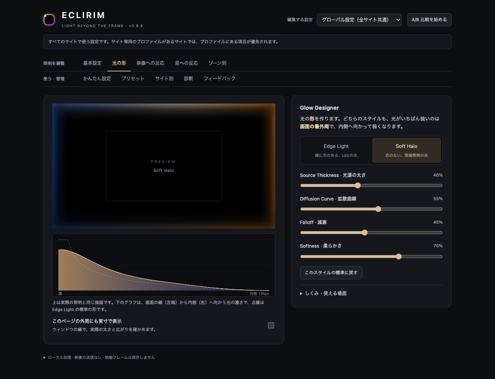
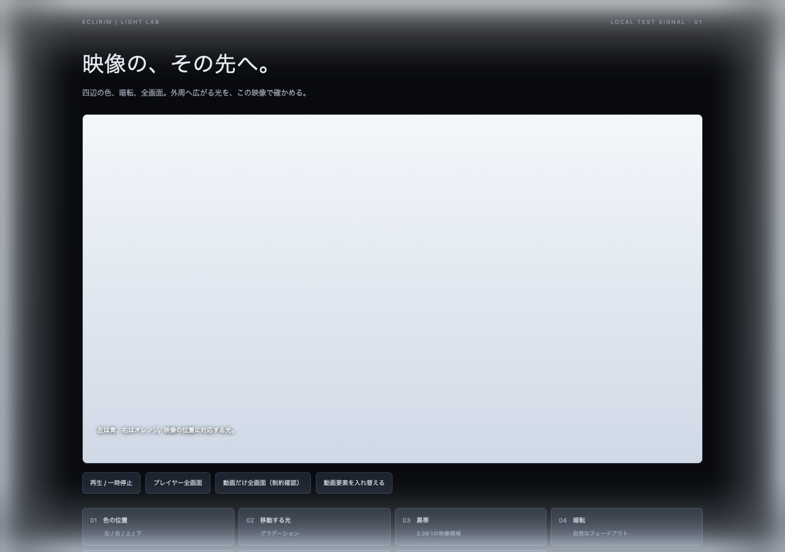
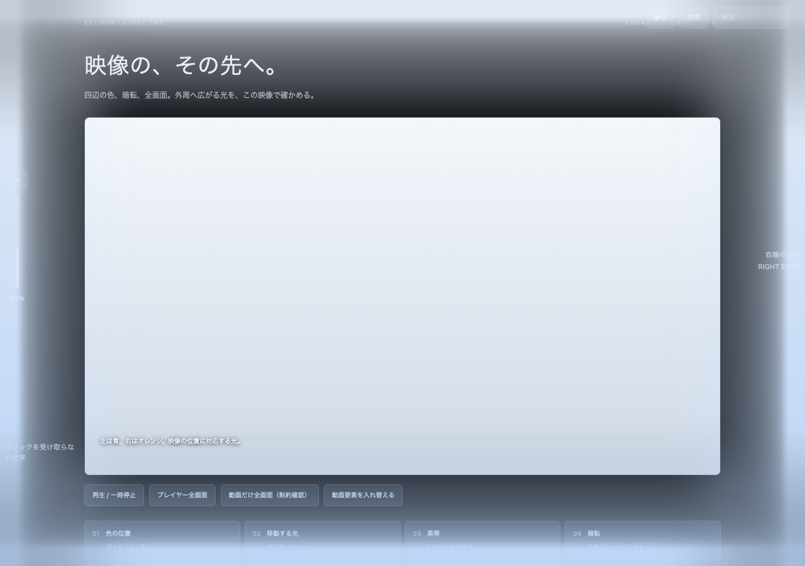
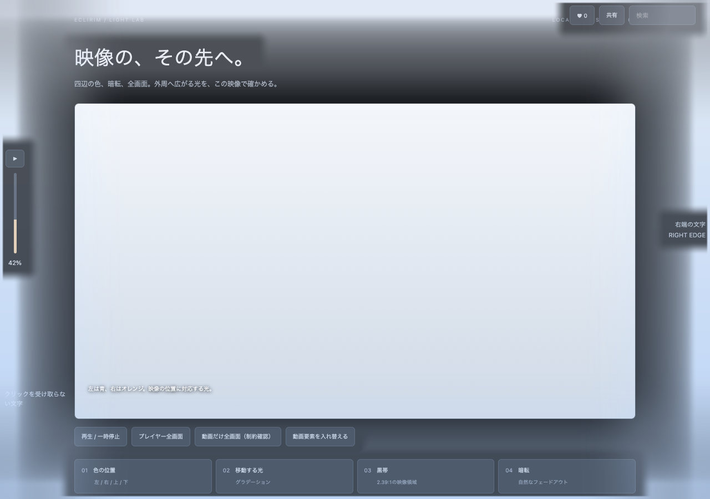
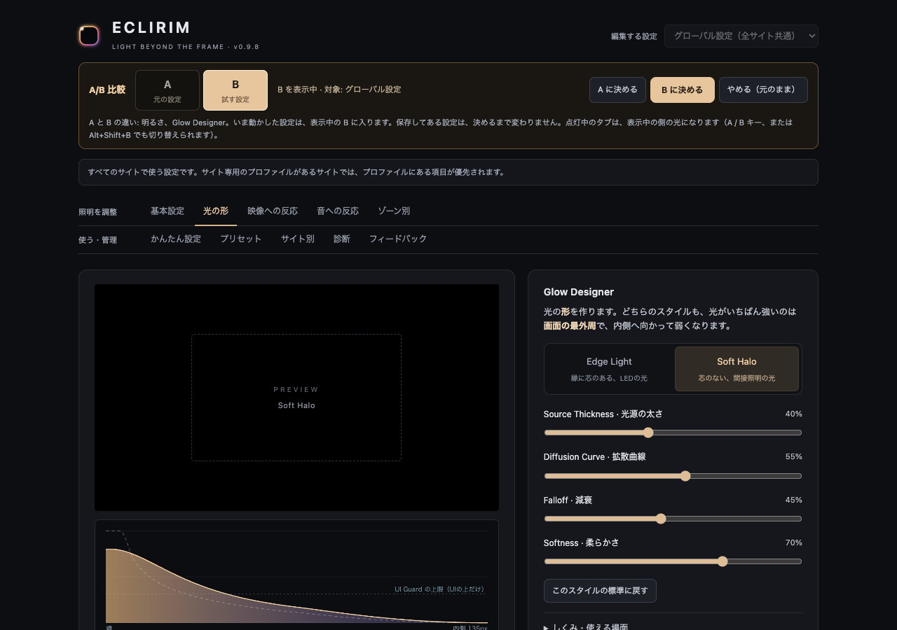
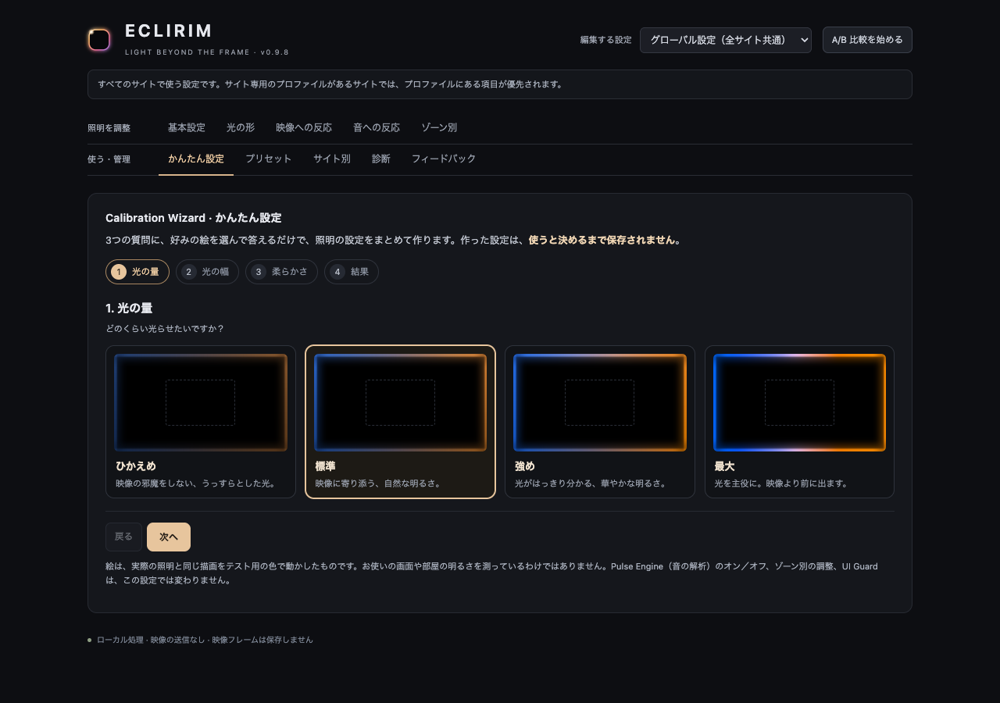

[English](README.md) | **日本語**

# ECLIRIM（エクリム）

映像の色と音に合わせて、ブラウザの画面外周を光らせるChrome拡張です。映像・音声の解析と照明は端末内で行います。

**0.9.9 · Global Update（Beta）** · [日英Release](https://github.com/VaporFOXChanber/ECLIRIM/releases/tag/v0.9.9) · [配布ZIP](https://github.com/VaporFOXChanber/ECLIRIM/releases/download/v0.9.9/ECLIRIM-0.9.9.zip) · [変更履歴](CHANGELOG.md) · [検証記録](docs/QA.md)

- 映像の色を四辺のゾーンへ反映し、光源や動きにも反応します。
- Cinema / Vivid / Ambientと、Edge Light / Soft Haloで見た目を調整できます。
- Pulse EngineとBeat Bloomで音に合わせた明るさ・広がりを付けられます。音の解析は初期設定ではオフです。
- UI Guard、明るさの自動調整、サイト別設定、プリセット、A/B比較を備えています。
- フィードバックには、本人が内容を確認したDiagnosticsの要約だけを任意で添付できます。

## 目次

- [Beta版の対応範囲](#beta版の対応範囲)
- [インストール](#インストール)・[更新手順](#更新する場合)
- [最新版の変更（0.9.9）](#099-global-update)
- [0.9.8の変更](#098-の変更確認してから診断要約を添付)
- [3つの描画経路](#3つの描画経路)
- [保護された動画（DRM）](#保護された動画drm)
- [実装した機能](#実装した機能)
- [全画面と画質について](#全画面と画質について)
- [検証範囲](#検証範囲)
- [権限とプライバシー](#権限とプライバシー)
- [ライセンス](#ライセンス)
- [Contributors](#contributors)
- [参照した一次資料](#参照した一次資料)

機能ごとの説明

- [名前とアイコン](#名前とアイコン)
- [Glow Designer（光の形）](#glow-designer光の形)
- [UI Guard（操作UI・字幕・文字の保護）](#ui-guard操作ui字幕文字の保護)
- [Adaptive Brightness（場面の明るさへの追従）](#adaptive-brightness場面の明るさへの追従)
- [A/B比較](#ab-比較)
- [かんたん設定](#かんたん設定calibration-wizard)
- [Pulse Engine（音に合わせた光）](#pulse-engine音に合わせた光)
- [Music Mode](#music-mode)
- [Color Engine 2.0](#color-engine-20)
- [Dynamic Light Trails](#dynamic-light-trails)
- [Preset Library](#preset-library)
- [Light Director](#light-director)
- [Zone Studio](#zone-studio)
- [Site Profiles](#site-profiles)
- [Performance Monitor](#performance-monitor)

過去の更新履歴

- [0.9.7：UI整理とフィードバック](#097-の変更ui整理とフィードバック)
- [0.9.6：UI Guardの上限超過を修正](#096-の修正ui-guardの上限超過)
- [0.9.5：Activeのまま光が消える問題を修正](#095-の修正activeのまま光が消える問題)
- [0.9.4：Pulse Engineをもう一段強く](#094-の変更pulse-engine-をもう一段強く)
- [0.9.3：Pulse Engineの強化](#093-の変更pulse-engine-の強化)
- [0.9.2：高解像度の動画での負荷を修正](#092-の修正高解像度の動画での負荷)
- [0.9.1：Identity Update](#091-の新機能identity-update)
- [0.9.0：Resonance Update](#090-の新機能)
- [0.8.0：Cinematic Update](#080-の新機能)

## Beta版の対応範囲

0.9.9もBeta（GitHub Pre-release）です。タグと拡張のバージョンは `v0.9.9` / `0.9.9` ですが、全環境を検証した安定版への昇格を意味しません。Chrome Web Storeへの提出は行っていません。

Chrome 116以降に対応します。主な動作確認はmacOSのChromeで行っており、Windows・Linux・Intel Macは未確認です。保護された動画の映像連動には制約があり、**macOSのChromeではNetflix・Prime Videoなどの保護された映像の色を取得できません**。選択した固定の照明は利用できます。詳しくは下の「保護された動画（DRM）」と [検証記録](docs/QA.md) を参照してください。

## インストール

1. [0.9.9 Global UpdateのRelease](https://github.com/VaporFOXChanber/ECLIRIM/releases/tag/v0.9.9) から **ECLIRIM-0.9.9.zip** をダウンロードします。「Source code」のZIPではありません。

2. ZIPを展開し、以後も使う場所へフォルダーを保存します。
3. Chromeで `chrome://extensions` を開き、「デベロッパー モード」をオンにします。
4. 「パッケージ化されていない拡張機能を読み込む」で、展開した **manifest.jsonが入っているフォルダー** を選びます。
5. 動画ページを開き、ECLIRIMアイコン →「このタブで照明を開始」。最初は「映像に連動 · RGB解析」のままで使えます。

拡張一覧の名前が **ECLIRIM**、バージョンが **0.9.9** ならこの版です。Alt+Shift+Gでもポップアップを開けます（競合時はChromeのショートカット設定で変更）。ReleaseにはZIPのSHA-256チェックサムを添付しています。

### 更新する場合

すでに読み込んでいるフォルダーと保存場所を保ち、中身だけ新しいZIPの内容へ置き換えます。そのあと `chrome://extensions` の更新ボタン（⟳）を押し、動画ページを再読み込みしてください。読み込む場所を変えると別の拡張機能として扱われ、保存した設定が見えなくなる場合があります。

光は動画の枠ではなく、Webページを表示している領域の四辺に出ます。タブバー・アドレスバー・OSのデスクトップには描画できません。

**一度開始したタブでは、同じサイトの中でページを移動・再読み込みしても、照明は自動で再開します（0.4.0）。** 戻る・進むでも再開します。同じページ内の動画差し替え・SPA遷移にも追従します。

**よく使うサイトは「このサイトでは常に点灯」をオンにできます（0.5.0）。** ポップアップの「映像・サイトの設定」を開くとあります。オンにするとChromeがそのサイトへのアクセス許可を一度だけ確認し、許可すると、そのサイトでは新しいタブでも、Chromeの再起動後でも、何も押さずに照明が始まります。

- 許可はサイト（ホスト名）ごとです。`www.youtube.com` と `music.youtube.com` は別のサイトとして扱います。Prime Videoを `www.amazon.co.jp` で見ている場合は、同じホストの買い物ページでも拡張が動きます（動画が無ければ光りません）。
- オフに戻すと、その許可をChromeへ返します。`chrome://extensions` のECLIRIMの詳細「サイトへのアクセス」からも取り消せます。
- ヘッダーのスイッチで照明をオフにしている間は、常時点灯のサイトでも始まりません。オンに戻すと、開いているタブも点灯します。

常時点灯にしていないサイトでは、次の場合にもう一度「照明を開始」を押してください。Chromeが拡張への一時的な許可を取り消すためです。

- 同じタブで別のサイトへ移動したとき（元のサイトへ戻ったあとも押し直しが必要です）
- 新しいタブやウィンドウで開いたとき
- Chromeを再起動したとき、拡張を更新したとき

照明をオフにしたタブは再開しません。「タブの映像を取得」はページ移動のたびに終了し、自動では再開しません。クロスオリジンiframe内の動画は元サイトで開いてください。

**YouTubeの一覧では、サムネイルにカーソルを載せたときのプレビュー再生では光りません（0.8.1）。** 動画を選んでいる間は「Waiting for Video」のままで、動画を開くと本編で点灯します。対象はYouTubeのプレビュー専用プレイヤーだけです。ほかのサイトの自動再生プレビューは、これまでどおり動画として扱います。

## 0.9.9 Global Update

ChromeのUI言語が日本語なら日本語、それ以外なら英語で表示します。詳細設定の上部にある「言語 / Language」で、自動・日本語・英語を選べます。手動の選択はChromeの再起動後も維持します。

ポップアップ、詳細設定の全10タブ、Calibration Wizard、プリセット説明、A/B比較、診断、フィードバック、エラー・補足・ツールチップを英語化しました。既存の設定キー・プロファイル・プリセット名・JSONバックアップは変更していません。言語は照明の設定と別に保存し、バックアップの読み込みや初期設定への復元では変わりません。

言語の切り替えではUIページだけを再表示し、動画の照明・A/B比較・保存済み設定には触れません。途中のWizardは最初から、診断添付は再確認になります。フィードバックの入力済み下書きは残ります。Chrome自身が表示する拡張説明とショートカット説明は、手動設定とは別にChromeのUI言語に従います。

[英語README](README.md)、[日英Release](https://github.com/VaporFOXChanber/ECLIRIM/releases/tag/v0.9.9)、[今回のQA](docs/QA-0.9.9.en.md) を用意しました。映像・音声解析、DRM制限、権限、CSP、フィードバックの送信形式とプライバシー保護は維持しています。配布ZIPはGitHubのPre-releaseに添付しています。

## 0.9.8 の変更（確認してから診断要約を添付）

フィードバックで「要約を作る」を押すと、点灯中のタブのDiagnosticsから、状態・fps・処理時間・ゾーン数・各機能の動作状態をまとめます。内容を読んで「この要約を確認し、フィードバックに添付する」をチェックした場合だけ、送信本文の末尾へ含めます。URL・タブ名・サイト別設定の名前・映像・音声は要約に含めません。

確認した要約は送信まで固定します。タブの変更・要約の更新・画面の開き直しでは確認を解除し、自動では添付しません。診断できるタブがない場合も、通常のフィードバックを送れます。受信側が要約に対応していない場合は、送信前に止めて知らせます。

操作とプライバシーの詳細は [UIの説明](docs/UI.md) を参照してください。

## 0.9.7 の変更（UI整理とフィードバック）

本文を開く

ポップアップの最初の表示に、プリセット・明るさ・光の幅をまとめました。細かな設定は用途別に折りたたみ、詳細設定の入口も「基本設定」「光の形」「映像への反応」「音への反応」などの日本語に整理しました。拡張一覧の説明文から「旧名」の表記を削除しています。

ポップアップ →「フィードバック」で、評価・感想・困りごと・改善案を入力できます。下書きは端末に保存され、プレビューを確認して「フィードバックを送る」を押すと開発者へ届きます。受信先のメールアドレスはサーバー側だけに保存し、利用者の画面と配布コードには含めません。送信できなかった場合も下書きは残り、コピーして取り出せます。

画面と操作の説明は [UIの説明](docs/UI.md) にあります。

## 0.9.6 の修正（UI Guardの上限超過）

本文を開く

ビートや明るい場面への切り替わりで、ボタン上の光がUI Guardの上限を一時的に超える不具合を修正しました。今描くフレームの明るさで保護を先に計算し、光を弱める保護は即時に適用します。保護を解除するときは、これまでどおり滑らかに光を戻します。Beat Bloomの広がりは維持します。

## 0.9.5 の修正（Activeのまま光が消える問題）

本文を開く

Canvasの描画状態が失われて復旧したあと、キャッシュされた光のマスクが透明のまま残る不具合を修正しました。動画の解析と描画は動き続けるため、状態はActiveのまま消灯していました。復旧イベントでマスクを描き直し、止まっている場面の光も再描画します。照明OFFは維持します。

## 0.9.4 の変更（Pulse Engine をもう一段強く）

本文を開く

Pulse Engine に、明るさだけでなく光の広がりを加えました。

- **Beat Bloom。** ビートのたびに、光が画面の内側へ広がります（100% で、届く深さが最大1.8倍。初期値 70%）。ポップアップの Pulse Depth の下にスライダーがあります。
- **明るい場面でもビートが見えます。** ビートのとき、濃さを上限の先まで持ち上げます（Flash Limiter がオフのときだけ）。
- **ビートが、目で追える速さで走ります。** 下辺の中央から上辺の中央まで、Beat Wave 100% で約0.32秒（0.9.3 は約0.16秒）。
- **UI Guard の保護範囲も広がります。** 光の広がりに合わせて、ボタンや文字を保護する範囲を拡張します。
- Flash Limiter がオンのときは、広がりは半分になり、上限の先への持ち上げは使いません。

## 0.9.3 の変更（Pulse Engine の強化）

本文を開く

Pulse Engine の明るさの変化とビートへの反応を強めました。

- **Pulse Depth は、画面で見える光の濃さをどれだけ動かすかになりました。** これまでは光の量に倍率を掛けていて、画面に出るまでに変化が約半分に圧縮されていました。40% で、ビートのとき最大1.6倍、ビートの間は約0.76倍です。
- **ビートが外周を走ります（Beat Wave）。** 低音のビートは下辺の中央から始まり、左右の辺を通って上辺へ届きます。設定ページの Pulse で速さを変えられます（0% で全周が同時）。
- **ポップアップに Pulse Depth のスライダー**があります（Pulse Engine がオンのときだけ表示）。
- **Flash Limiter がオンでも、ビートの瞬間だけは光を一度に少し動かせるようにしました**（持ち上げは最大の明るさの8%まで、ビートは1秒に3回まで）。映像の明滅に対する Flash Limiter は変えていません。**Pulse Engine をオンにしたときの明滅は、Flash Limiter がオンでも 0.9.2 より大きくなります。** 穏やかにしたいときは Pulse Depth を下げてください。

## 0.9.2 の修正（高解像度の動画での負荷）

本文を開く

1080p や 4K の動画で、Light Director が「負荷が高いため、いまは休止しています」のまま戻らないことがありました。重かったのは Light Director ではなく、動画のフレームを読み出す処理です。0.9.2 で次のように直しました。

- **読み出しをGPUで縮小してから行います。** これまでは、Chromeがデコード済みのフレームをまるごとGPUから取り出していたため、動画の解像度が高いほど時間がかかりました。高解像度の動画での読み出し負荷を抑えます。
- **光は変わりません。** GPUでの読み出しは、従来の読み出しと結果が一致する動画でだけ使います（動画ごとに最初のフレームで照合します）。HDRの動画とライブ映像は、これまでどおりに読みます。
- **負荷を理由に Light Director を止めません。** 解析が遅いときは、Light Director が見る画素と回数を減らすだけです。
- 読み出しにかかった時間と読み出し方は、Diagnostics の「開発者向けの詳細」とHUDで見られます。

## 0.9.1 の新機能（Identity Update）

本文を開く

開発者向けの設計説明は [docs/IDENTITY.md](docs/IDENTITY.md) にあります。

### 名前とアイコン

名前が **ECLIRIM** になり、アイコンとロゴを新しく作りました（暗い面の縁から光がもれるマーク）。変わったのは見た目と名前だけです。

| 変えたもの | 変えていないもの |
|---|---|
| 拡張機能の名前・ツールバーのタイトル・アイコン | 拡張機能のID（マニフェストに `key` は入れていません） |
| ポップアップと設定ページの表記 | 保存データの場所（`settings`・`profiles`・`presets`） |
| 書き出すJSONの `"app"` とファイル名、配布zipの名前 | 権限、CSP、対応するChromeの版 |
| ページに差し込む要素のID（`eclirim-…`） | 同じ展開先を使う更新方法 |
| GitHubのリポジトリ名（`ECLIRIM`） | |

CineGlow の頃に書き出したプリセット・バックアップ（`"app": "CineGlow"`）は、そのまま読み込めます。

### Glow Designer（光の形）

ポップアップの **GLOW STYLE** で2つのスタイルを切り替えます。細かい形は、設定ページの **Glow Designer** タブで作ります。

- **Edge Light。** これまでの照明です。縁に細い芯があり、そのすぐ内側に強いにじみ、さらに内側へ薄い広がりが続きます。
- **Soft Halo。** 芯を作らず、縁からなだらかに落ちる1つの光にします。いちばん強いところでも濃さは80%までで、辺に沿って隣の色とも混ざります。

| スライダー | 働き |
|---|---|
| Source Thickness · 光源の太さ | いちばん強く光る部分の幅（Edge Light の芯）。標準の1/4〜4倍 |
| Diffusion Curve · 拡散曲線 | 落ち方の形。低いと縁で急に落ちて長く尾を引き、高いと縁の近くを保ってから落ちる |
| Falloff · 減衰 | 内側へどれだけ早く消えるか。標準の1/2〜2倍の速さ |
| Softness · 柔らかさ | 芯の境目のぼかしと、辺に沿った色の混ざり具合（角を回り込んで混ざります） |

- **どちらのスタイルでも、どのスライダーの位置でも、光がいちばん強いのは画面の最外周で、内側へ向かって強くなることはありません。**
- **Edge Light の4つのスライダーがすべて50%のとき、光の形は 0.9.0 と同じです。**
- 「光の幅」「光の拡散」（Lighting タブ）は、この形が届く範囲と量を決めます。Zone Studio でオフにしたゾーンには、隣の色は流れ込みません。DRM互換描画の光にも同じ形を使います（辺に沿った色の混ざりを除く）。

### UI Guard（操作UI・字幕・文字の保護）

光は、ページの上に重ねた色の層です。濃いところでは、下にあるボタンや文字が読みにくくなります。UI Guard は、光の下にあるボタン・リンク・入力欄・スライダー・アイコン・文字を探し、**その真上とすぐ周りだけ**、光の濃さに上限を掛けます。

| UI Guard オフ（Overkill） | UI Guard オン |
|---|---|
|  |  |

- **何も無い場所の光は変えません。** 画面の最外周の線（6pxまで）も、ボタンの真上であっても光らせたままにします。
- **必要なときだけ働きます。** 見ているのは「光の形」だけでなく、その場所のLEDがいまどれだけ強く光っているかです。暗い場面のように、もともと光が上限より薄いときは何もしません。標準の設定では、ほとんどの場面でほぼ変化がなく、Overkill のような強い設定で大きく効きます。
- **消えたUIは保護をやめます。** 動画プレイヤーの操作バーのように、フェードアウトしたもの（透明度0）は対象から外し、また現れたらすぐに保護します。
- **ポインターのまわり。** マウスを縁の近くで動かしている間は、その周囲の光もすぐに弱めます。見つけられないUIへの備えです（オフにできます）。
- **Guard Strength · 弱める強さ。** 上限の濃さを決めます。0%で60%、初期値の60%で約31%、100%で12%です。
- **プリセットは UI Guard を変えません。** Overkill を選んでも、UI Guard はお使いの設定のままです。

**しくみと限界。** 縁の近くの点に何があるかをページに問い合わせて調べます（クリック位置の判定と同じ方法で、画素は読みません）。文字は「あるかどうか」だけを見て、内容は読みません。次のものは見つけられません。

- 動画に組み込まれた標準のコントロール（`<video controls>` のバー）と、canvas の中に描かれたUI
- クリックを受け取らない要素（`pointer-events: none` の字幕や文字）、動画の中に焼き込まれた字幕、標準の字幕（`::cue`）
- 別サイトの埋め込み（iframe）の中身

また、DRM互換描画の光はChromeがページの合成で作るため、UI Guard は掛けられません。字幕は多くの場合、光が上限より薄い位置（縁から離れた位置）にあります。

### Adaptive Brightness（場面の明るさへの追従）

映像全体の明るさを見て、光の強さを整えます。初期設定はオンです。

| 場面 | 働き |
|---|---|
| 暗い場面 | 明るいゾーンの光だけを抑え、暗いゾーンは変えません |
| 中くらいの場面 | 変えません |
| 明るい場面 | 光を全体に下げます（初期値で25%、スライダー100%で50%） |

- 「場面の明るさ」は、映像全体の知覚的な明るさの平均です。暗い場面に小さな光が1つあっても、暗い場面として扱います。
- 変化はゆっくりです（初期値で約1.4秒の時定数。場面が大きく切り替わったときは速く追従します）。そのあと、いつもの時間の平滑化と Flash Limiter を通ります。
- Dark Scenes・Bright Scenes のスライダーを0%にすると、その側だけ働きを止められます。
- 映像を解析できる照明（映像に連動 · RGB解析、タブ取得）でのみ働きます。固定の照明・Music Mode・DRM互換描画では働きません。

### A/B 比較

いまの設定（**A**）と、試したい設定（**B**）を、同じ映像で切り替えて見比べます。

1. ポップアップか設定ページで「A/B 比較を始める」を押す。A と B は、どちらもいまの設定から始まります。表示は B に切り替わります。
2. 設定を動かす。明るさ、Glow Style、Light Director、プリセットの適用など、照明の見た目に関する設定はすべて、**表示中の側にだけ**入ります。
3. A・B を切り替えて見比べる。ポップアップ・設定ページのボタン、キーボードの A / B、`Alt+Shift+B`（Chromeのショートカット。全画面のままでも切り替えられます）が使えます。点灯中のタブは、すぐに表示中の側の光になり、画面の上に「A を表示中」「B を表示中」と数秒出ます。
4. 「A に決める」「B に決める」「やめる」のどれかで終わる。

- **決めるまで、保存してある設定は変わりません。** 決めたときも、書き込むのは前と違う項目だけです。
- 比較は、編集している設定（グローバル設定か、あるサイトのプロファイル）に付きます。そのプロファイルを使うサイトのタブだけが、比較中の光になります。
- 照明のオン／オフ、照明のソース、ゾーン数などの全サイト共通の設定は、比較の対象外です（動かすとすぐ保存されます）。
- 途中の比較は、Chromeの再起動と拡張機能の更新で終了します。保存してある設定は、比較の前のままです。

### かんたん設定（Calibration Wizard）

ポップアップの「かんたん設定 · Wizard」か、設定ページの「かんたん設定」タブから開きます。

**光の量**（ひかえめ／標準／強め／最大）、**光の幅**（細い／標準／広い）、**柔らかさ**（くっきり／標準／ふんわり）の3つを、絵を見て選びます。絵は、実際の照明と同じ描画をテスト用の色で動かしたものです。3つ選ぶと、照明の設定がまとめて出来上がります。

- 出来上がった設定は、**そのまま使う**、**いまの設定と A/B で比べる**（おすすめが B に入ります）、**プリセットとして保存する**、のどれかを選べます。選ぶまで何も保存しません。
- 3つとも「標準」を選ぶと、初期設定（Cinematic Balanced）と同じになります。
- 画面や部屋の明るさを測っているわけではありません。好みを設定に置き換えるだけです。
- Pulse Engine（音の解析）のオン／オフ、ゾーン別の調整、UI Guard は変えません。

## 0.9.0 の新機能

本文を開く

開発者向けの設計説明は [docs/RESONANCE.md](docs/RESONANCE.md) にあります。

### Pulse Engine（音に合わせた光）

再生中の音を低・中・高の3つの音域で聞き、ビート・爆発音・効果音に合わせて**光の強さ**を変えます。**色は映像のまま**です。

- **初期設定はオフです。** ポップアップの「Pulse Engine · 音に反応」か、設定ページの Pulse でオンにしたあとだけ、音を読みます。プリセットの適用やバックアップの読み込みで、勝手にオンになることはありません。
- **再生音は変えません。** プレイヤーの音の「写し」を受け取り、音域ごとの大きさを読むだけです。写しはどこにも出力せず、録音・保存・送信もしません。プレイヤーのミュート・音量・再生速度にも触れません。
- **動かすのは変化だけです。** 各音域を直近の大きさと比べ、急に大きくなったところで光を持ち上げます。一定の音は、どれだけ大きくても光を動かしません。静かな作品でも大きな音の作品でも、同じように反応します。
- 低音は下の辺に、高音は上の辺に強く出ます。Pulse Depth（深さ）、Bass / Mid / Treble（音域ごとの量）、Beat Sensitivity（ビートの感度）、Beat Wave（ビートが外周を走る時間。0.9.3）、Beat Bloom（ビートで光が広がる量。0.9.4）を調整できます。
- **Flash Limiter は音で動かした光にも掛かります。** オンの間は、ビートへの反応を1秒に3回までにします。0.9.3 から、ビートの瞬間だけは光を一度に少し動かせます（上の「0.9.3 の変更」を参照）。
- プレイヤーがミュート中は、光は動きません。

働かない場面：

- **保護されたコンテンツ（DRM）。** 音は解析しません。音の写しをChromeに要求することもしません。
- **別のサイトから配信されている音。** Chromeが読み取りを許可しません（映像を直接読めない動画と同じ条件です）。
- DRM互換描画（CSS）と、タブの映像を取得している間。
- Chromeのタブのミュート（タブの右クリックから）は検出していません。その状態でも光は反応します。

### Music Mode

照明のソースの1つです。映像を使わず、**音だけ**で光らせます。低音は下の辺を暖色で、高音は上の辺を寒色で照らし、色合いはゆっくり揺らぎます。無音では消灯します。映像のない音声プレイヤーだけのページでも働きます。選ぶと音を読みます（Pulse Engine のスイッチがオフでも）。

### Color Engine 2.0

色の読み取りと階調を見直しました。設定ページの Lighting にあります。

- **暗い場面**：暗い色が「消える」のではなく「暗く光る」ようになります（Shadows）。色がノイズでしかない暗さでは、色を付けずに無彩色にします。
- **明るい場面**：明るい側を切り捨てずに、なだらかに丸めます（Highlights）。Vivid や高い明るさでも、明るいゾーン同士の差が残ります。ゾーンの中の白い光に色が薄められるのも抑えます。
- **彩度**：くすんだ色ほど大きく、鮮やかな色は控えめに上げます（Vibrance）。ディスプレイに出せない鮮やかさは、色相を保ったまま収めます。
- **広色域**：広色域（Display P3・BT.2020）の映像は、P3対応のディスプレイでは Display P3 のまま読み取り、P3で光らせます。
- **HDR**：HDRの映像かどうかは検出して Diagnostics に表示します。ただし、ページから読める画素はChromeがSDRへ変換したあとの値で、HDRの明るさそのものは取り出せません。光もSDRで描きます。
- **オフにすると、0.8 までの色の扱いにそのまま戻ります。**

0.8.x から更新すると、暗い場面が少し明るく色づき、非常に明るいゾーンの最大値がわずかに下がります。

### Dynamic Light Trails

Light Director が追いかけている光源が動くと、通った場所の外周に残光を残します。止まっている光源には付きません。効果がはっきり出るのは、辺の近くを通る光です（辺から遠い光は、もともと辺を広く照らすため差が小さくなります）。設定ページの Light Director にスイッチと、長さ・強さがあります。

### Preset Library

照明の見た目をまとめて切り替えます。ポップアップの「プリセット」か、設定ページの Presets から適用します。

| プリセット | 向き |
|---|---|
| Cinematic Balanced | 初期設定。映画に合わせた、自然でなめらかな光 |
| Vivid Action | アクションやゲーム映像。鮮やかで、動きと音への反応が速い |
| Soft Ambient | 長時間の視聴。広く淡く、ゆっくり変わる光 |
| Midnight Subtle | 暗い部屋で深夜に。細く控えめで、暗い場面の色を残す |
| Overkill | すべてを最大近くまで。光が映像より前に出ます |

- プリセットが変えるのは見た目だけです。ゾーン別の調整、照明のソース、Pulse Engine のオン／オフはそのまま残ります。どのプリセットも Flash Limiter はオンのままです。
- いまの設定を名前を付けて保存できます。プリセットは1つずつJSONファイルに書き出し、ファイルか貼り付けで読み込めます。
- 「すべての設定を書き出す」は、グローバル設定・サイトのプロファイル・自分のプリセットをまとめたバックアップです。サイトへのアクセス許可は含まれません（Chromeが管理しています）。
- 読み込んだJSONは保存時と同じ検査を通し、知らない項目は捨てます。読み込んだプリセットは一覧に追加するだけで、自動では適用しません。バックアップは、確認のボタンを押してから置き換えます。

## 0.8.0 の新機能

本文を開く

細かい設定は**設定ページ**にあります。ポップアップの「詳細設定」か、`chrome://extensions` のECLIRIMの「拡張機能のオプション」から開きます。目的別に整理された全10タブから調整できます。

### Light Director

これまでの照明は、各辺に接する帯の色だけを見ていました。Light Director は、映像全体から次の2つを見つけて、近い辺へ足します。

- **光源の候補**：まわりよりずっと明るい場所（ランプ、爆発、窓、ネオン）。画面の中央にあっても、四辺へ少しずつ届きます。
- **急に現れた光**：画面の一部だけが急に明るくなった場所。短く反応します。場面の切り替わりや画面全体の明滅には反応しません。

光源の候補を追って動きの方向を求め、進む先へ少しだけ先回りして光らせます（照明は平滑化のぶん遅れるためです）。フレームの差からは方向がわからないので、方向はこの追跡からだけ求めています。

初期設定はオン・強さ35%で、控えめです。足した光にも OKLab の平滑化と Flash Limiter が掛かり、くり返す点滅は自動で弱めます。オフにすると、0.7.x と同じ照明に戻ります。

知っておいてほしいこと：

- 明るいだけで光っていないもの（白い服、明るい壁、画面内の白いパネル）も、候補になることがあります。気になるサイトでは、Light Source Sensitivity か Effect Strength を下げるか、プロファイルでオフにしてください。
- 画面の上下にある横長の帯（字幕の形）は光らせません。何分も変わらない明るい部分（局のロゴなど）は、ゆっくり対象から外します。形と時間だけの判定なので、外れることがあります。画面中央のテロップは対象外です。
- 映像を解析できる照明（「映像に連動 · RGB解析」）でだけ働きます。DRM互換描画・固定の照明・保護された動画では働きません。
- 暗い場面ほどよく効き、明るい昼間の場面ではほとんど何も足しません。辺のすぐ近くの光は、従来の照明がすでに出しているので足しません。

設計の詳細は [docs/LIGHT_DIRECTOR.md](docs/LIGHT_DIRECTOR.md) にあります。

### Zone Studio

設定ページの Zone Studio で、ゾーンを選んで個別に調整できます。

- 外側の区切りをクリックして選択。Shift＋クリックで範囲、⌘ / Ctrl＋クリックで追加・解除。「上辺」「下辺」などで辺ごとにまとめて選べます。
- 調整できるのは、明るさ・彩度・光の広がり（0〜200%）と、光らせる／光らせないです。
- プレビューは実際の照明と同じ描画です。テストパターンは Sample Scene / Rainbow / Red・Green・Blue / Moving Light / Corner Test / Brightness Gradient / Zone Identification の7種類。Zone Identification は選んだゾーンだけを光らせます。「このページの外周にも実寸で表示」で、ウィンドウの縁でも確かめられます。プレビューに映像は使いません。
- ゾーンには1からの連番が付きます（上辺の左から、下辺、左辺、右辺の順）。
- 調整は**辺の上の位置**で保存します（各辺96分割）。ゾーン数が64から128に変わっても、解像度による自動調整で変わっても、同じ場所に同じ調整が掛かります。
- 光らせないゾーンは、隣のゾーンへなめらかにつながります。辺を丸ごとオフにしても、両端の半ゾーンぶんは、隣の辺の角の光とつながります。
- DRM互換描画（CSS）では、ゾーン別の調整は使われません。

### Site Profiles

サイト（ホスト名）ごとに、照明の見た目を保存できます。

- 保存できる項目：照明モード、明るさ、光の幅、光の拡散、彩度、滑らかさ、追従速度、Flash Limiter、Light Director の設定、Zone Studio の調整。
- プロファイルは**グローバル設定と違う項目だけ**を持ちます。変えていない項目は、グローバル設定をあとから変えれば一緒に変わります。
- ポップアップの「このサイト専用にする」で作れます。作ったあとは、そのサイトのポップアップでの変更がプロファイルに保存されます。「グローバルに戻す」は2回押すと削除します。
- 設定ページの Profiles では、作成・編集・複製・項目ごとにグローバルへ戻す・削除ができます。ホスト名を入力して、まだ開いていないサイトの分も作れます。ローカルファイルは `file` です。
- 照明のオン／オフ、照明のソース、保護された動画での照明、ゾーン数、診断の設定は、プロファイルに含まれません（全サイト共通）。
- **プロファイルは設定を保存するだけです。** サイトへのアクセス許可は求めません。「このサイトでは常に点灯」とは別の機能で、プロファイルがあるだけでは自動で点灯しません。
- Netflix・Prime Video のプロファイルも作れますが、保護された動画が映像に連動するようにはなりません。

### Performance Monitor

設定ページの Diagnostics に、点灯中のタブの計測値を表示します。

- 通常の表示：状態、描画方式、Analysis FPS、Rendering FPS、ゾーン数、Light Director の状態、使っているプロファイル。
- 開発者向けの詳細：解析時間（うち 映像の読み出し、Light Director）、映像の読み出し方（0.9.2）、描画時間、最初の描画までの遅延、品質の段階、遅れた解析、抜けた描画フレーム、予算を超えた処理の回数、キャプチャ状態、光源の候補の速度など。
- **HUD**：オンにすると、点灯中のタブの左上に計測値を小さく表示します。クリックは素通しします。初期設定はオフです。
- 値はすべてタブの中で実際に計ったものです。**CPU使用率・GPU使用率は表示しません。** 拡張機能からはタブごとの正確な値を取得できないため、処理にかかった時間と予算超過の回数で代えています。
- 表示されていないタブは休止するため、同じウィンドウの別のタブからは動いている様子を見られません。設定ページを別のウィンドウに出すか、HUDを使ってください。
- 解析が長く続けて遅いときは、解析の細かさを4段階で自動的に下げます（オフにもできます）。短い負荷では切り替えず、戻すときは長く待ちます。最後の段階では解析の回数を半分にします。**どの段階でも Light Director は止めません**（0.9.2 から。0.9.1 までは最後の段階で休止し、高解像度の動画では戻りませんでした）。

## 3つの描画経路

| 経路 | 処理 | できること | 制約 |
|---|---|---|---|
| 動画の直接解析 | HTMLVideoElement → 縮小Canvas → 局所RGB | 32〜128ゾーン、OKLab平滑化、Flash Limiter、黒帯推定 | CORS・暗号化メディア等で取得できない場合がある |
| タブ取得 | 明示的なボタン操作 → tabCapture → Offscreen | 直接解析ができない一般動画で同じRGB処理 | 非表示・停止・ページ移動で終了。再開操作が必要。光を除外するため映像内側を使用 |
| DRM互換描画 | CSS backdrop-filter（SVGフィルター）+ 外周マスク | ピクセルをJavaScriptへ取り出さず、ブラウザ内部の合成だけで、各辺に向かい合う映像の色をその辺へ出す。黒帯ごしでも届く。暗い場面は透明 | **MacのChromeでは、保護された映像には効かない**（映像が合成から見えない層に表示される）。ゾーン数の指定・色の時間平滑化・Flash Limiter・黒帯の検出は行わない。字幕やプレイヤーの操作部も色に混ざる |

## 保護された動画（DRM）

**MacのChromeでは、Netflix・Prime Videoなどの保護された映像に連動する照明は作れません（0.7.0で確認）。** Chromeは保護された映像を、画面キャプチャからも、ページ自身の合成からも見えない別の層に表示します。その上に重ねた互換描画には映像の色が一切入りません。保護の仕組みそのものなので、回避はしません。

そのためMacのChromeでは、保護された動画を検出すると次のようにします。

- 状態は「Protected Content」と表示し、映像の色を取り出せないことをそのまま伝えます。連動しているようには見せません。
- 初期設定では照明を出しません（0.7.1から）。「保護された動画での照明」で、Cinemaプリセット・ゆっくり変化・固定カラーのどれかを選ぶと、固定の照明を表示します。選んだ照明は映像には連動しません。

Mac以外のChromeでは、保護された動画で互換描画を試します。そこで光るかどうかは確認できていません。

**自動切り替え。** 「映像に連動」を選んでいるとき、次の場合は画素を読まずにDRM互換描画を使います。保存した設定は書き換えないので、YouTubeなどに戻ればRGB解析に戻ります。

- NetflixまたはPrime Videoのページで、保護されていない動画（予告編など）を再生しているとき
- Mac以外で、再生中の動画に暗号化（`encrypted` イベントまたは `mediaKeys`）を検出したとき

固定カラー・プリセット・ゆっくり変化を選んでいる場合は切り替えません。ポップアップには、いま使っている方式と、その理由を表示します。

互換モードは「Compatibility Mode」と表示します。64ゾーン解析が利用できているとは表示しません。保護映像の合成に成功しているか、拡張からピクセルを検査できないため、明るい場面で発光を目視確認してください。発光しない環境では固定色・Cinemaプリセット・ゆっくり変化する照明を選べます。

**保護された動画の画質と再生を守るため、**Netflix・Prime Videoおよび検出済みの暗号化動画に対するタブ取得を開始前に拒否します。互換描画はタブ取得を必要としません。途中で暗号化動画に切り替わった一般サイトでも取得を終了します。

## 実装した機能

- 初期手動値64ゾーン、上・下・左・右へ均等配分。各辺の対応領域を局所サンプリング。
- モニター解像度に応じた自動ゾーン数。フルHD=64、WQHD=96、4K=128を目安に32〜128へ丸める。
- 自動計算は `screen` のCSS寸法 × devicePixelRatio ÷ ページズーム。モニター間移動・DPI変更へ追従。Chromeが公開する推定値であり、パネルのネイティブ解像度・EDIDを取得するものではありません。
- 32 / 64 / 96 / 128の手動指定。互換描画は連続したCSS光のためゾーン数を使用しません。
- Cinema / Vivid / Ambient。
- 明るさ、幅、拡散、彩度、滑らかさ、追従速度、固定色、プリセット、Flash Limiter。幅は光がほぼ消える位置の目安で、ごく淡い裾はその1.5倍まで伸びます（光の端が枠に見えないようにするため）。
- 光として描画（0.2.0）。各ゾーンの色は色相を保ったまま最大輝度のLED色にし、映像の明るさは光量（不透明度）で表します。最外周に細い高輝度の発光帯、そこから内側へにじむ光。粒状LEDは描画しません。
- 暗い場面・暗転では光が透明になります。ページや映像の端を暗い色で塗ることはありません。
- 一時停止中は止めた場面の光を保ちます。終了でフェードアウト。シークや短い読み込みでは点滅させず、3秒を超える停止で消灯します。
- 隣り合うゾーンは光の量でなめらかに補間（2次Bスプライン）。角は両辺の光を弱めて重ね、角だけ明るくならないようにしています。
- ゾーンの代表色はリニア光で平均。暗い背景の中の明るい被写体が埋もれにくくなります。
- OKLab補間、シーン変化検出、暗転時のフェード、線形輝度の変化速度制限。
- 約12fpsで縮小解析（縮小はGPUで行い、小さくなった画素だけを読み出します。0.9.2）、最大30fpsで描画。停止中はフレームが変わったとき（シーク）だけ解析し、光が落ち着いたら描画ループを休止。
- 黒帯は対称性・一様な黒・内部の明るさ・約1秒の継続を条件に推定。暗いシーン全体や片側だけの黒は除外しません。ただし対称的な黒い画面内容との完全な識別はできません。
- 表示面積と再生状態による動画選択、DOM差し替え、open Shadow DOM内の動画検出。
- Fullscreen APIでプレイヤーのコンテナ内へ光レイヤーを移動。リサイズ・解除時にも追従。
- 設定はchrome.storage.localへ保存。映像と色は保存しません。
- Light Director、Zone Studio、Site Profiles、Performance Monitor（0.8.0。上の「0.8.0 の新機能」を参照）。
- Pulse Engine、Music Mode、Color Engine 2.0、Light Trails、Preset Library（0.9.0。上の「0.9.0 の新機能」を参照）。

## 全画面と画質について

YouTube等の**プレイヤー全体の全画面**に対応します。`video` 自体・iframe自体が全画面のトップレイヤーになる場合、標準DOMオーバーレイを重ねられないため「Fullscreen Unsupported」を表示します。動画のDOM再配置・複製・アスペクト比変更は行いません。

光源は表示領域の最外周にあるため、映像が画面いっぱいに表示されているときは光が映像の端に重なります。重なるのは明るい光で、0.1.0のように映像の端が暗くなることはありません。重なりを減らしたい場合は「光の幅」「光の拡散」を下げてください。黒帯や余白がある側では、その部分が光ります。

互換描画は元のvideo要素にCSS Filterを適用せず、別レイヤーにbackdrop-filterを適用します。光の形（細い発光帯と内側へのにじみ）はRGB解析と同じで、中央は透明のまま映像をそのまま見せます。

0.6.0で互換描画の色の取り方を作り直しました。0.5.0までは画面全体を同じ強さでぼかしていたため、黒帯のある映画では上下の辺と角が弱くなり、色の位置もぼやけていました。配信の黒帯は映像の中に焼き込まれていることが多く、画素を読まない互換描画では位置を検出できません。そこで、上下の辺は縦に深く・横に浅く、左右の辺は横に深く・縦に浅くぼかし、黒帯をまたいで映像の色が届くようにしました。色の左右・上下の位置は保たれます。プレイヤーが作る余白（位置が分かる黒帯や、ページ内の小さな動画）は、その分だけ詰めて映像の端から色を取ります。暗い場面では光が透明になり、ページや映像を暗く塗りません。

RGB解析との違いが残る点：黒帯の行では左右の辺は光りません（その行に映像が無いため）。場面転換での色の変化はなめらかにできません。字幕やプレイヤーの操作部が出ている間は、その色も光に混ざります。ページ内の小さな動画では、光るのは映像に向かい合う範囲だけです。

GPU合成で得られる映像の範囲はOS・Chrome・DRM構成ごとに異なります。ハードウェアアクセラレーションを無効にするなどの回避策は実装・推奨しません。CSS互換描画でも他の環境で画質変化や負荷が出ないことを保証するものではありません。

## 検証範囲

このパッケージでは型検査・クライアント単体100件・ビルドが成功しました。ブラウザーE2Eと実際のフィードバック配送は再実行していません。Windows・Linux・Intel Mac、Chrome 116、長時間利用、商用DRM配信、実機のモニター間移動は未確認です。すべての環境での動作を保証する安定版ではありません。詳しくは [検証概要](docs/QA.md) を参照してください。

## 権限とプライバシー

| 権限 | 用途 |
|---|---|
| activeTab | ユーザーが拡張を開いたタブだけで開始。同じサイトにいる間はChromeが許可を保つため、ページ移動後の再開にも使用 |
| scripting | Content Scriptを必要時に注入 |
| storage | 言語の選択、設定、サイト別のプロファイル、プリセット、フィードバックの下書きと再試行用ID、現在の取得先tab ID、照明を開始したタブのID（Chromeを閉じると消える領域） |
| tabCapture | 明示操作による一般動画タブの映像のみ取得 |
| offscreen | タブ取得をポップアップの外で処理 |
| （任意）サイトへのアクセス | 「このサイトでは常に点灯」をオンにしたサイトだけ。Chromeの確認を経て、そのホスト名に限って取得。オフにすると返却 |

インストール時に要求するサイトへのアクセスはありません。常時点灯を選んだサイトだけ、あとから個別に許可を求めます。tabs、マイク、デスクトップ全体のキャプチャ権限は要求しません。常時点灯のサイトでも、タブ取得は自動では始まりません。映像と音の解析・照明は端末内で行い、映像のアップロード・録画・保存・外部解析サービス・遠隔コードはありません。

**フィードバックについて（0.9.7）。** 送信ボタンを押したときだけ、入力した内容と拡張のバージョンをGoogle Apps Scriptの受信窓口へ送り、開発者のメールボックスへ転送します。ページのURL、Cookie、映像・音声、診断データは自動添付しません。受信先は配布コードに含めません。拡張の権限とCSPは増えていません。

**診断要約について（0.9.8）。** 「要約を作る」を押したときだけ既存の診断機能から読み取り、本人が確認してチェックした場合だけ送信します。要約と確認状態は下書きに保存せず、画面を開き直すと解除します。タブを選ぶための名前は画面内だけで使い、要約へ含めません。

**UI Guard について（0.9.1）。** 点灯中のタブで、光の下（ページの縁の近く）にボタンや文字があるかを、ページに問い合わせて調べます。調べるのは要素の位置と大きさ、見えているかどうか、文字が「あるかどうか」だけで、文字の内容・入力欄の中身・画素は読みません。マウスポインターの位置は、縁の近くの光を弱めるために、その瞬間の値だけを使います。どれも端末の中だけで使い、保存も送信もしません。UI Guard をオフにすると、この調べはすべて止まります。

**音について（0.9.0）。** 初期設定では、音には一切触れません。Pulse Engine をオンにするか Music Mode を選んでいる間に限り、点灯中のタブで再生中の動画・音声の「写し」をChromeから受け取り、音域ごとの大きさを端末の中で読みます。写しはどこにも出力せず、録音・保存・送信もしません。プレイヤーの音声経路は付け替えず、再生音・ミュート・音量には触れません。保護されたコンテンツの音は要求しません。マイクや、タブ取得の音声は使いません。

停止・非表示・タブ切替・ページ移動・動画消失・終了でタブ取得を終了します。設定のOFFでレイヤーとタイマーを停止し、ストリームの全トラックをstopしてOffscreenを閉じます。再開の自動取得はありません。互換描画から外部へ送るデータもありません。

## ライセンス

ECLIRIMは **[PolyForm Strict License 1.0.0](LICENSE)** で提供します。非商用目的などの利用を対象とし、ソフトウェアの再配布や改変・派生物作成の許可は含みません。適用条件はLICENSEの原文を確認してください。依存ツールには、それぞれのライセンスが適用されます。

配布ZIPにもLICENSE原文を同梱しています。

## Contributors

- [VaporFOXChanber](https://github.com/VaporFOXChanber) — 企画・メンテナンス
- Codex (OpenAI) — AIによる開発支援
- Claude (Anthropic) — AIによる開発支援

## 参照した一次資料

ソースのビルド・テスト手順と設計資料は [開発者ガイド](docs/DEVELOPMENT.md) を参照してください。

- [Chrome: tabCapture](https://developer.chrome.com/docs/extensions/reference/api/tabCapture) — ユーザー操作とStream ID、Chrome 116以降のOffscreen利用。
- [Chrome: Audio recording and screen capture](https://developer.chrome.com/docs/extensions/how-to/web-platform/screen-capture) — Service WorkerとOffscreenの経路。
- [Chrome: offscreen](https://developer.chrome.com/docs/extensions/reference/api/offscreen) — runtime経由の通信と寿命。
- [MDN: backdrop-filter](https://developer.mozilla.org/en-US/docs/Web/CSS/Reference/Properties/backdrop-filter) — 後景の合成とBackdrop Root。
- [CSS Filter Effects Level 2（草案）](https://drafts.csswg.org/filter-effects-2/) — フィルター、変形、マスクの合成順序。

保護された動画の制約は [DRM_COMPATIBILITY.md](docs/DRM_COMPATIBILITY.md) を参照してください。

[目次に戻る](#目次)
