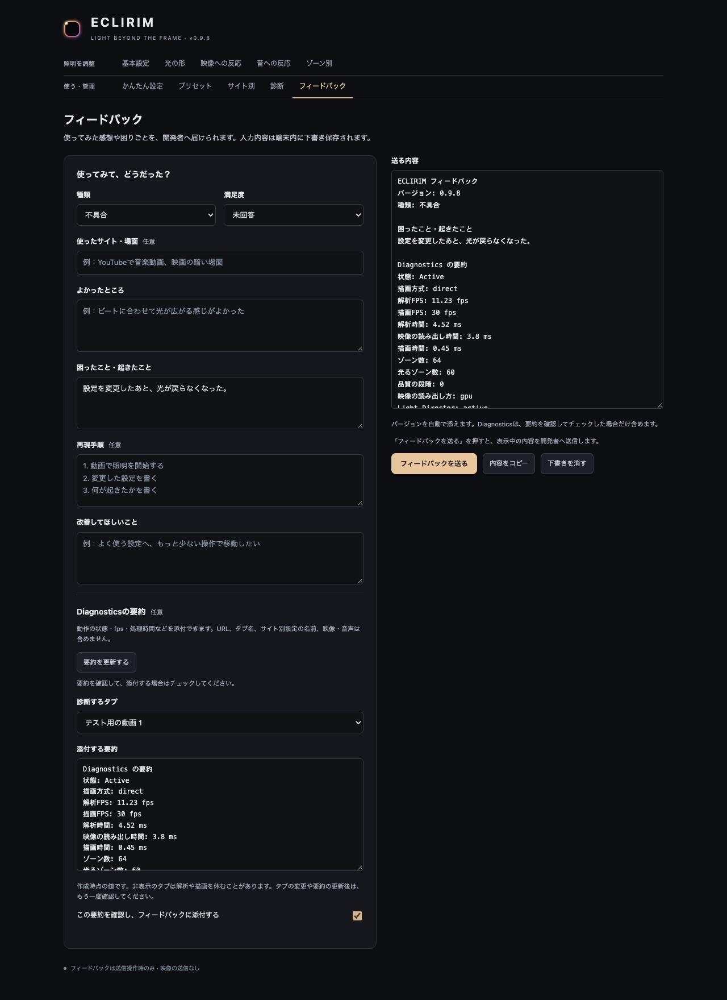
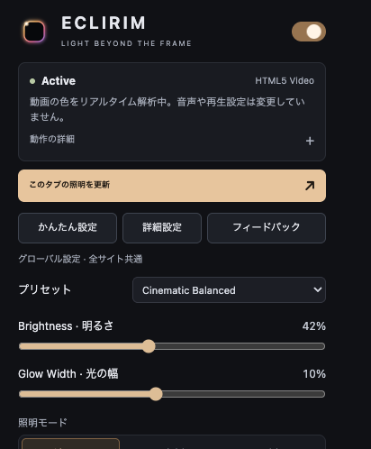
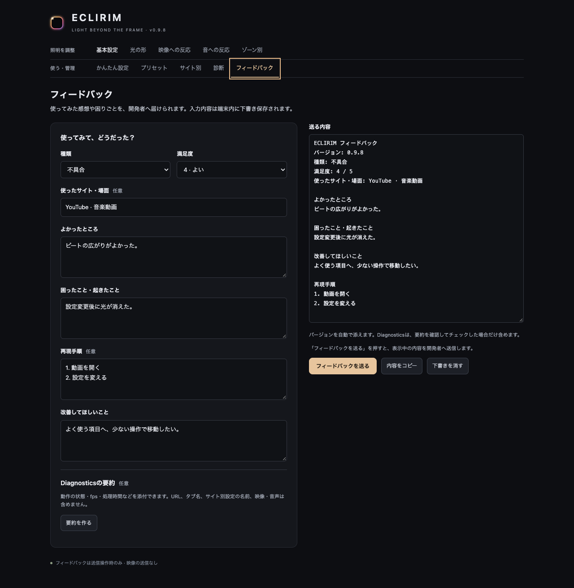

# フィードバックと診断要約の使い方

## 画面の構成

普段のポップアップでは、状態を確認して、プリセット・明るさ・光の幅を調整する。設定画面では、目的別の入口から細かく調整する。

## フィードバック

種類（感想・評価／不具合／改善案）、満足度、使った場面、よかったところ、困ったこと、改善案を入力する。不具合では再現手順も記入できる。内容は端末内に下書き保存し、送る内容をプレビューで確認できる。

宛先のメールアドレスを利用者に渡さないため、メール作成画面を開く方式は使用しない。Google Apps Scriptの受付URLへ、送信ボタンを押したときだけ内容を送る。サーバーだけが固定の受信先を持つ。開いているページのURL、Cookie、診断データは自動で添付しない。

コピー用テキストも利用できる。コピーできなかった場合は全文を選択し、ショートカットでコピーできるようにする。長文を切り捨てない。下書きの消去は2回押しとし、消去確認中に編集すると確認を取り消す。

送信中は入力と二重押しを防ぐ。受付IDが一致した成功応答だけを成功とし、接続エラーや受付制限では下書きを残す。同じ内容を再試行するときは、同じIDを使用する。自動再送は行わない。

## Diagnosticsの要約（0.9.8）

「要約を作る」を押すと、点灯中のタブの診断を一度だけ読み取り、添付用の要約を表示する。タブを選ぶための名前は画面内だけで使う。状態・描画方式・fps・解析／読み出し／描画時間・ゾーン数・品質段階・機能の状態を選び、URL・タブ名・サイト別設定の名前・詳細メッセージ・映像・音声を含めない。

要約を読んで「この要約を確認し、フィードバックに添付する」をチェックすると、「送る内容」の末尾に同じ要約が加わる。ファイルとしてではなく、メール本文の一部として送る。確認後にライブの値で取り直さない。タブ変更と要約の更新ではチェックを外し、画面の開き直しでは要約と確認状態を復元しない。通常の入力下書きは従来どおり保存する。

読み取り中は送信を待ち、失敗・対象なしの場合は添付せずに送れる。下書きの消去後に遅れて返った診断結果は表示しない。要約を添付できない場合は送信前に知らせる。

詳しい導入方法は [日本語ガイド](../README.ja.md)、検証の範囲は [QA](QA.md) を参照してください。

